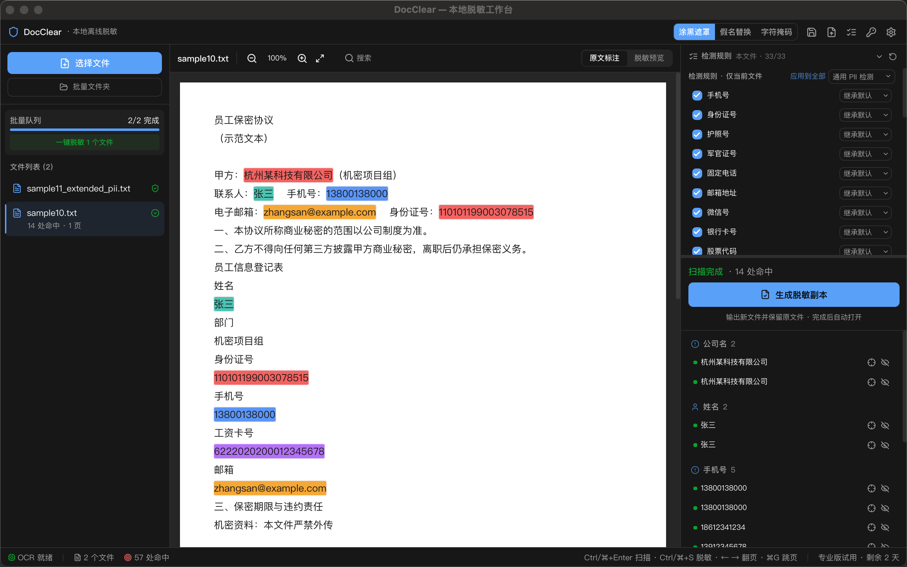

# DocClear

**本地优先的敏感信息脱敏工具** —— 截图、PDF、Word 里的身份证号、银行卡、手机号、人脸，
OCR 自动识别，一键抹除。所有处理 100% 在本地完成，数据不出你的电脑。

## 下载

前往 [Releases](../../releases/latest) 获取最新安装包，或前往官网 <https://docclear.dao123.vip/> 下载：

| 平台 | 安装包 |
|---|---|
| Windows | `.exe`（NSIS 安装包） |
| macOS（Intel + Apple Silicon 通用） | `.dmg` |
| Linux | `.deb` / `.AppImage` |
| CLI / MCP 服务 | 各平台 `.tar.gz` / `.zip` |

> macOS 首次打开若提示「无法验证开发者 / 已损坏」（应用未做 Apple 公证，属正常）：
>
> 方法一：拖入「应用程序」后右键点图标 →「打开」即可（仅首次）。
>
> 方法二：若右键打开仍被拦截，终端执行 `xattr -dr com.apple.quarantine /Applications/DocClear.app` 后正常双击启动。

## 特性

- 🔍 OCR 自动检测敏感信息（证件号 / 银行卡 / 手机号 / 人脸等）
- 🖥️ 桌面应用 + CLI + MCP 服务（可接入 AI 助手自动脱敏）
- 🔒 完全本地运行，无需联网，无需上传
- 🆓 社区版永久免费

## 说明

本仓库为 DocClear 官方**构建与发布渠道**，源代码暂不开放。
问题反馈与商务合作请通过官网联系。
